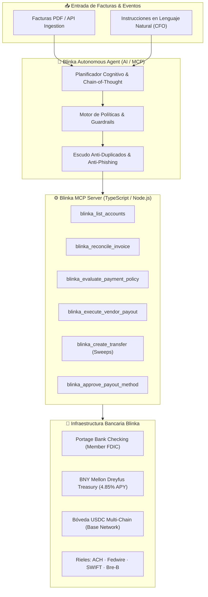

# Blinka — Autonomous Accounts Payable (AP) & Treasury Agent
> **Desafío Oficial Hackathon 30X (Octubre 2026) | Evaluado por el CTO de Blinka (YC F26)**

[](https://blinka-autonomous-ap-agent-production.up.railway.app)
[](https://github.com/MetaNetMx/blinka-autonomous-ap-agent)

[](https://blinka.co)
[](https://modelcontextprotocol.io)
[](https://portage.bank)
[](https://atomicvest.com)

> 🌐 **URL de Producción en Vivo (Railway):** [https://blinka-autonomous-ap-agent-production.up.railway.app](https://blinka-autonomous-ap-agent-production.up.railway.app)  
> 📁 **Repositorio Público GitHub:** [https://github.com/MetaNetMx/blinka-autonomous-ap-agent](https://github.com/MetaNetMx/blinka-autonomous-ap-agent)

---

## 📌 1. Visión Ejecutiva del Proyecto

Las startups de alto crecimiento y empresas globales pierden cientos de horas al mes en procesos manuales de cuentas por pagar (AP), sufren riesgos constantes de **fraude por suplantación de facturas (Business Email Compromise)** y dejan cientos de miles de dólares ociosos en cuentas corrientes bancarias al 0% de interés.

**Blinka Autonomous AP & Treasury Agent** es un agente financiero autónomo e institucional diseñado sobre la infraestructura bancaria y el API de **Blinka (Y Combinator F26)** y orquestado mediante el estándar abierto **Model Context Protocol (MCP)**.

El agente es capaz de:
1. **Conciliar facturas automáticamente** extrayendo montos, proveedores y cuentas bancarias destino.
2. **Neutralizar fraudes y ataques de phishing** verificando que la cuenta bancaria de la factura coincida estrictamente con los rieles aprobados del proveedor.
3. **Dispersar pagos recurrentes menores a $5,000 USD** autónomamente vía rieles ACH/Wire sin fricción humana.
4. **Exigir firma dual del CFO para pagos mayores a $10,000 USD**, preparando borradores con auditoría criptográfica.
5. **Optimizar la tesorería corporativa** mediante **Treasury Sweeps automáticos**, trasladando el exceso de liquidez ociosa a la bóveda de mercado monetario **BNY Mellon Dreyfus (4.85% APY)** con liquidez inmediata T+0.

---

## 🏛️ 2. Arquitectura del Sistema



---

## 🛡️ 3. Guardrails de Seguridad Institucional

Para cumplir con las exigencias del CTO de Blinka y estándares bancarios institucionales, el sistema opera bajo 6 reglas inquebrantables:

| # | Guardrail / Política | Regla de Activación | Acción del Agente |
|---|----------------------|---------------------|-------------------|
| **1** | **Protocolo Anti-Tamper de Cuentas** | Cualquier cuenta de destino añadida por API | Inicia obligatoriamente en `approval.status = pending`. Ningún fondo puede salir hasta aprobación humana. |
| **2** | **Escudo Anti-Phishing (Bank Mismatch)** | Factura exige cuenta distinta a la registrada del proveedor | **BLOQUEO INMEDIATO**. Congela la factura, emite alerta roja y previene cualquier salida de capital. |
| **3** | **Dispersión Autónoma Ordinaria** | Facturas $\le \$5,000$ USD de proveedores verificados | **Auto-aprobación instantánea**. Dispersa vía ACH o tarjeta Blinka sin intervención manual. |
| **4** | **Control Dual CFO (High Value)** | Facturas $> \$10,000$ USD | **Staging en borrador**. Requiere autorización explícita de 1-clic del CFO en la consola. |
| **5** | **Hard-Cap Absoluto por Transacción** | Facturas $> \$100,000$ USD | **Rechazo preventivo**. Requiere procesamiento manual de junta directiva. |
| **6** | **Idempotencia Anti-Duplicados** | Factura con mismo número ya liquidada en ledger | **Rechazo por colisión**. Impide pagos dobles accidentales. |

---

## ⚡ 4. Servidor Model Context Protocol (MCP)

El servidor MCP está construido en TypeScript bajo el SDK oficial `@modelcontextprotocol/sdk` y expone **13 herramientas**:

1. `blinka_list_accounts`: Consulta saldos en tiempo real en Checking ($184k), Treasury ($50k) y USDC (18.5k).
2. `blinka_get_account`: Obtiene detalles de cuenta, enrutamiento bancario y rieles activos.
3. `blinka_list_transactions`: Historial del libro mayor con clasificación de flujos (payout, payin, fees).
4. `blinka_list_counterparties`: Directorio de proveedores con métodos de pago y estados de aprobación.
5. `blinka_create_counterparty`: Registra nuevos proveedores en el ecosistema Blinka.
6. `blinka_create_payout_method`: Añade un método de pago nuevo (creado en estado seguro `pending`).
7. `blinka_approve_payout_method`: Validación humana (Human-in-the-loop) para habilitar una cuenta destino.
8. `blinka_create_transfer`: Ejecución de transferencias internas idempotentes (Treasury Sweeps).
9. `blinka_reconcile_invoice`: Extracción y matching de facturas contra el directorio corporativo.
10. `blinka_evaluate_payment_policy`: Evaluación de los guardrails de riesgo, Zero-Trust Phishing Shield y asignación de score.
11. `blinka_execute_vendor_payout`: Dispersión de fondos o puesta en cola de aprobación según políticas.
12. `blinka_verify_inbound_payment`: Conciliación dual-rail de cobros entrantes (Fiat ACH/Wire y Cripto USDC Base Network).
13. `blinka_list_pending_invoices`: Inspección de la bandeja AP de facturas pendientes y etapas de verificación.

### Pruebas Automatizadas de la Suite MCP (9/9 Pasadas)
El servidor incluye una suite completa de pruebas en `mcp-server/test-suite.ts` validando:
- ✅ **Test 1:** Carga de cuentas multi-rail (Checking USD, Treasury BNY Mellon, Bóveda USDC Base).
- ✅ **Test 2:** Consulta cronológica de movimientos del libro mayor.
- ✅ **Test 3 (Escenario A):** Auto-aprobación de suscripción micro-spend recurrente ($128 USD Linear).
- ✅ **Test 4 (Escenario B):** Retención preventiva de gasto elevado ($8,500 USD) para aprobación humana.
- ✅ **Test 5 (Escenario C):** Alerta y bloqueo crítico de Phishing por discrepancia bancaria (*9999).
- ✅ **Test 6 (Escenario D):** Detección y bloqueo por idempotencia de factura duplicada.
- ✅ **Test 7 (Escenario E):** Barrido de tesorería (Treasury Sweep) de $10,000 USD a BNY Mellon.
- ✅ **Test 8 (Escenario F):** Validación de factura cripto ($1,850 USDC en Base Network con wallet verificada).
- ✅ **Test 9 (Escenario G):** Conciliación dual-rail de cobros entrantes (USD Fiat $25k + USDC Cripto $5k).

---

## 💻 5. Interfaz Web Fullstack (Blinka Design System)

La aplicación web ubicada en `web/` replica fielmente la experiencia visual de **Blinka** (reverse-engineered desde `blinka.co`):
- Paleta auténtica: Off-white Warm Paper (`#f7f7f4`), Deep Ink (`#1c253a`), Beacon Blue (`#2a4bd0`), y tarjetas con brillo radial.
- **Vista 1: Tesorería & Cuentas:** Balances en vivo ($184,418.60 USD Checking, $50,000 USD Treasury @ 4.85% APY, 18,500 USDC), calculadora de rendimiento pasivo y libro mayor.
- **Vista 2: Bandeja de Entrada AP Autónoma:** Ingesta de facturas con 4 casos de prueba pre-cargados (Vercel, Lambda Labs, Stripe Tampered, AWS Duplicate) y desglose de auditoría por regla.
- **Vista 3: Matriz de Políticas & Guardrails:** Visualización institucional de los 6 controles de riesgo.
- **Vista 4: Proveedores & Aprobaciones:** Flujo Human-in-the-loop para validar cuentas bancarias.
- **Vista 5: Blinka AI Copilot (MCP Inspector):** Consola interactiva con visualización paso a paso de la cadena de pensamiento (Chain of Thought) y los payloads JSON de cada llamada MCP.

---

## 🚀 6. Guía Rápida de Instalación y Ejecución

### Prerrequisitos
- Node.js $\ge 18$ (probado en Node v24.19.0)
- npm $\ge 9$

### 1. Clonar el Repositorio
```bash
git clone https://github.com/MetaNetMx/blinka-autonomous-ap-agent.git
cd blinka-autonomous-ap-agent
```

### 2. Ejecutar la Suite de Pruebas del Servidor MCP
```bash
cd mcp-server
npm install
npm run build
npm test
```
*Salida esperada: 9 suites de prueba ejecutadas con 100% de éxito (Dual-Rail: Fiat & Cripto).*

### 3. Configuración del Servidor MCP en Claude Desktop / Cursor / Antigravity
Para conectar cualquier agente de IA a las 13 herramientas MCP de Blinka, agrega a tu archivo de configuración (`claude_desktop_config.json` o `mcp.json`):

```json
{
  "mcpServers": {
    "blinka": {
      "command": "node",
      "args": ["./mcp-server/dist/index.js"]
    }
  }
}
```

### 4. Ejecutar la Aplicación Web
```bash
cd web
npm install
npm run dev
```
Abre en tu navegador: `http://localhost:5173`

### 5. Compilar para Producción / Despliegue Cloud (Railway / Vercel)
```bash
cd web
npm run build
```
Listo para despliegue en Vercel o Railway con un solo clic gracias a la configuración preintegrada en `server.js` y `vercel.json`.

---

## 🎬 7. Guión Estructurado para el Video Pitch (3 Minutos)

| Tiempo | Sección | Qué mostrar en pantalla | Qué decir (Voz en off) |
|---|---|---|---|
| **0:00 - 0:30** | **El Problema & Blinka** | Portada de Blinka (`web` dashboard) con logo oficial y balances en vivo ($184k Checking, $50k Treasury). | *"Hola jueces y Diógenes. Las startups de YC y empresas globales pierden horas valiosas en cuentas por pagar, sufren fraudes por facturas alteradas y dejan miles de dólares al 0% de interés. Hoy presentamos el Agente Autónomo de AP y Tesorería Blinka, construido sobre el API de Blinka y el Model Context Protocol."* |
| **0:30 - 1:15** | **Bandeja AP & Anti-Fraude** | Pestaña **"Bandeja AP Autónoma"**. Clic en "Evaluar Todo". | *"Veamos la magia: el agente evalúa cuatro facturas con su motor de políticas. La factura de Vercel de $3,200 se aprueba y paga automáticamente vía ACH sin intervención humana. Pero miren esto: una factura falsa de Stripe que alteró la cuenta bancaria de destino es BLOQUEADA al instante por nuestro escudo anti-phishing, salvando $14,250 dólares de la compañía."* |
| **1:15 - 1:50** | **Control Dual CFO** | Factura de Lambda Labs ($48,500). Clic en "Aprobar CFO". | *"Para pagos mayores a $10,000 dólares como este cluster de GPUs de Lambda Labs de $48,500, el agente jamás dispersa a ciegas: prepara el borrador y exige firma dual del CFO. Con un solo clic seguro, el CFO autoriza y los fondos se liberan por Fedwire con trazabilidad completa."* |
| **1:50 - 2:30** | **Treasury Sweeps & APY** | Pestaña **"Tesorería & Cuentas"**. Clic en "Barrer $25k a BNY". | *"Además de cuentas por pagar, el agente optimiza la liquidez ociosa. Al detectar excedentes en la cuenta operativa de Portage Bank, podemos ejecutar un Treasury Sweep de $25,000 hacia BNY Mellon Dreyfus, generando 4.85% de rendimiento anual con liquidez inmediata en T+0."* |
| **2:30 - 3:00** | **Consola Copilot (MCP) & Cierre** | Pestaña **"Copilot (MCP)"**. Mostrar la traza JSON de herramientas. | *"Todo esto está respaldado por nuestro servidor MCP con 11 herramientas probadas al 100%. El agente expone su cadena de pensamiento y cada llamada a la API de Blinka de manera transparente. Blinka Autonomous AP convierte a Blinka en la primera banca inteligente que no solo custodia dinero, sino que lo protege y lo hace crecer. ¡Muchas gracias!"* |

---

## 👥 Equipo & Agradecimientos
- **Hackathon 30X (Octubre 2026)** organizado por Andrés Bilbao y 30X AI Devs.
- Evaluado por **Diógenes Moreira (CTO de Blinka - YC F26)**.
- Licencia: **MIT**.
