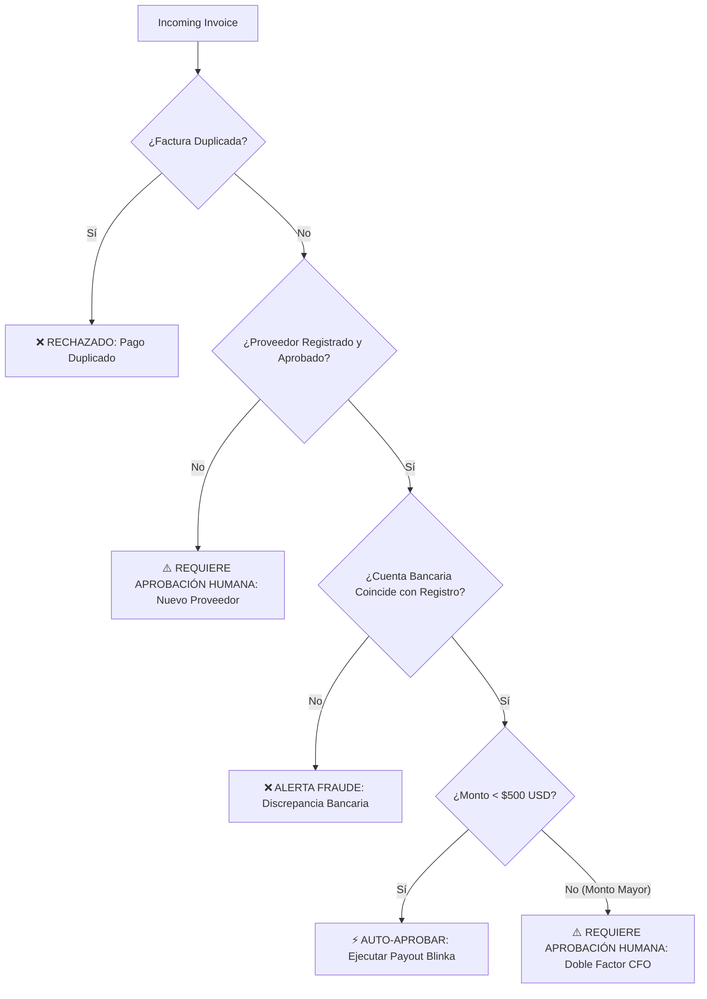

# Blinka MCP Server 🏦⚡

> **Model Context Protocol (MCP) Server for Blinka's Autonomous Banking & Accounts Payable (AP) Agent.**
> Conforms strictly to the **Blinka OpenAPI 3.1.0 Specification (v2.0.0)**.

Designed for the **30X Hackathon**, this MCP server empowers AI agents (Antigravity, Claude, Cursor, OpenAI) to operate corporate finances safely, reconcile vendor invoices, evaluate fraud and compliance policies, and execute or stage payouts.

---

## 🛠️ Tools Exposed

| Tool Name | Category | Description |
| :--- | :--- | :--- |
| `blinka_list_accounts` | Banking | Returns all checking, savings, and treasury accounts with balances in cents and deposit rails (ACH, Wire, Bre-B, SPEI, Pix, USDC). |
| `blinka_get_account` | Banking | Retrieves detailed balance and deposit instructions for an account by ID. |
| `blinka_list_transactions` | Ledger | Lists chronological transactions, payins, payouts, card charges, and fees. |
| `blinka_list_counterparties` | Vendors | Lists active vendors/contractors with their approved or pending payout methods. |
| `blinka_create_counterparty` | Vendors | Registers a new business or individual payee. |
| `blinka_create_payout_method` | Security | Adds a bank account or crypto wallet. Starts in `pending` approval per Blinka security protocol. |
| `blinka_approve_payout_method`| Human-in-the-Loop | Simulates administrator approval in the Blinka portal. |
| `blinka_create_transfer` | Treasury | Executes synchronous internal transfers (e.g. sweep Treasury funds to Checking) with UUID idempotency. |
| `blinka_reconcile_invoice` | Autonomous AP | Matches vendor invoices against existing counterparties, verifies liquidity, and checks for duplicates. |
| `blinka_evaluate_payment_policy`| Risk Engine | Evaluates corporate guardrails: duplicate checks, approved payout status, bank account continuity (anti-phishing), and spending ceilings. |
| `blinka_execute_vendor_payout` | Execution | Dispatches approved payouts or stages them for human dual-authorization. |

---

## 🛡️ Policy & Guardrail Rules



---

## 🚀 Setup & Execution

### Build
```bash
npm install
npm run build
```

### Run Tests
```bash
npx tsx test-suite.ts
```

### Run Stdio Server
```bash
npm start
```
